# Stream avatar: options and the chosen witch design

Constraints: no licence fee and no attribution burden. Rendering happens in
the browser on a canvas. No runtime dependency or third-party call from guests'
browsers; chosen art is vendored as static assets. Expressions (idle, blink,
talk, think, react) are driven by recorded log events.

Frames in this folder are generated by `make_witch.py` (run `python3 make_witch.py` here). The style references used for v3 are third-party art and are kept privately on the host, outside this repo.
DiceBear previews load from their public API for viewing only; the site would
vendor generated SVGs and never call the API.

## Chosen direction: chubby grey witch (own drawing, v3 concept)

A small, chubby young witch with grey hair, a pale grey witch hat with a
bent tip and a teal charm, and a red **apple-peel scarf**: a red band with a
cream "flesh" edge, a spiral peel tail, and a little leaf at the knot. Her
palette is taken from the Nesbitt-bot avatar's colours (light grey ground,
greys from pale to charcoal, one red-orange accent, a small teal accent). The
drawing itself is original, not traced from that art.

v3 changes (following private third-party style references, used only as a style guide and never published):
- **Lines:** dark-navy line art (`#2d2f4e`, not black), about 3 px outer and 2 px inner lines.
- **Fills:** flat colours with **one hard-edged shadow tone**. Shadows sit under the brim on the bangs, under the bangs on the face, on the inner side locks and the robe, plus one highlight band on the hair.
- **Hair (v3.1):** slightly **asymmetric**, after the Nesbitt-bot avatar's side-swept look.
  - Bangs sweep to the left, with an off-centre part and tips that lengthen toward the left eye.
  - The left side lock is longer and tied with a **teal bead**, with a loose strand flicking out.
  - The right lock is shorter and tucked under a pale **X-shaped hair clip** with a teal dot.
  - A warm rose-grey tint sits inside the locks (`#a8949c`).
- **Eyes:** **chubby eyes**. They are round and slightly wide, with a thin outline, and a thick lash arc floating just above them with a **tiny even gap**. The **muted** grey-teal iris (`#5c6e73` / `#8ea3a7` / `#c5d2d3`) holds a small navy **pupil ringed by a thin light gap**, plus two white highlights.
- **Face:** a hatched blush and an "ω" mouth.
- **Hat:** **0.75x of v2** (1.5x the original). The brim edge now overlaps the bangs so the head sits inside the crown. It is a 320×320 transparent canvas.

Hat shading:
- brim: a thick edge, a darker underside and a shadow inside the crown;
- crown: a shaded left side, a fold crease and a shaded bent tip, plus wrinkles and a side highlight;
- band: dark grey with a highlight line and stitching;
- charm: a teal gem with a highlight.

| idle | blink | talk | think | sleepy |
| --- | --- | --- | --- | --- |
|  | 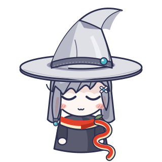 | 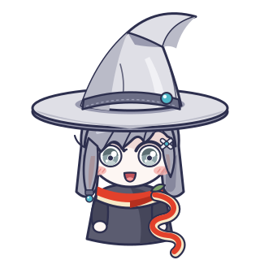 | 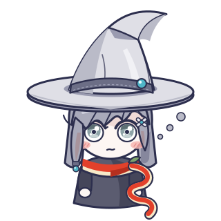 | 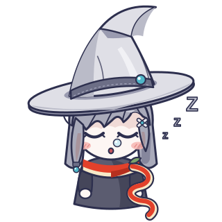 |

**sleepy** shows while the stream host runs on the paid OpenAI fallback, because the
free CPA quota has run out. Her eyes are **fully closed**: a bold "‿" lid line with small lashes. She has a tiny "o" mouth and a snot bubble,
the hat slips 8° to one side, and "z z Z" drift beside her face. It is worked out in the browser from recorded events.

Palette: hat `#e3e3e7`/`#d7d7dc`, band `#7f8089` (stitching `#5f6069`), shading `#bfc0c7`/`#9fa0a8`; hair `#9a9ba5`–`#a9aab4`,
outline `#7d7e88`; skin `#fbf1ec`, blush `#f1b1a9`; eyes `#3a3b44` with
`#5f939d` iris; robe `#54545d`/`#74747e`; peel `#e2412b` with `#f4e7c6` edge
and `#b8301f` shading; leaf `#7da36c`; charm `#4fb6c8`.

Built for later Live2D: every part is its own named layer. The SVG group ids are
`hair-back`, `robe`, `scarf`, `face`, `blush`, `eyes`, `mouth`, `bangs`,
`side-locks`, `hair-decor`, `brim-shadow` and `hat` (`hat-brim-back`, `hat-cone`, `hat-band`, `hat-charm`); they map to separate Live2D art layers.
Canvas phase A animates them by swapping or offsetting parts:
- blink: eyes swap;
- talk: mouth swap, driven by `model_output`;
- think: raised eyes and thought dots, during `model_start` or tool runs;
- idle breathing: a 1–2 px vertical bob of the head layers;
- hat-tip sway and scarf-tail sway: small rotations.

Next art passes after you approve: a wave/greet pose, happy and error
expressions, a back view of the hat for the Live2D head turn, and a matching
palette for the cat widget.

## Earlier options (superseded)

## Option A1: own drawing, "bot" (recommended)

Drawn by us as canvas primitives (rounded rects and ellipses), so we own it outright
and no file needs vendoring. It has the cheapest frames: blink, talk (mouth ellipse), think
(antenna light colour), and react (eye shape). It matches the dashboard's dark theme.

| idle | blink | talk |
| --- | --- | --- |
| 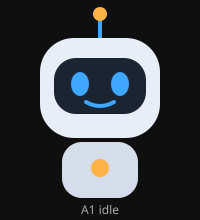 | 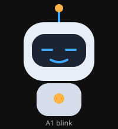 | 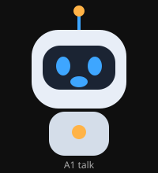 |

## Option A2: own drawing, line-face character

Drawn by us with a hand-drawn line style. Warmer and more human; it costs a few
more paths per frame. Expressions come from swapping mouth, eye and blush paths.

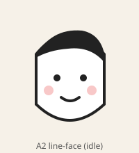

## Option A3: own drawing, pixel art (16×18 grid)

Drawn by us. It is crisp at any scale with `imageSmoothingEnabled = false`. Frames are tiny
grids, easy to author and to animate in steps. It suits a retro overlay style.

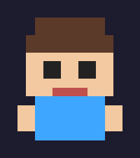

## Option B: DiceBear CC0 styles (vendored SVGs)

These are CC0 1.0 (no attribution) per https://www.dicebear.com/licenses/ (checked
2026-11-05). We would generate a few fixed variants (eyes and mouth) once and vendor
them, then animate by swapping variants. Animation is limited to expression swaps.
They are not rigged.

| Lorelei | Notionists | Open Peeps | Pixel Art | Thumbs |
| --- | --- | --- | --- | --- |
|  |  |  |  |  |

Avoid these DiceBear styles: Adventurer, Big Ears, Micah, Personas and the others marked CC BY 4.0 (they
need attribution), and Avataaars/Bottts (the artist's own terms).

## Option C: Kenney CC0 character packs

CC0 per https://kenney.nl/support ("free to use them, even in commercial
projects"; credit is optional; do not use the Kenney logo). Pick a character from
https://kenney.nl/assets (e.g. the Toon Characters / mini character packs) and
vendor the sprite frames. This gives the most finished art, but style choice is limited to what
exists, and frames are pre-made sprites, not drawn on the canvas.

## Cat widget (lower-right): own canvas drawing

Drawn by us in our own style. Do not copy the original "Bongo Cat" meme art,
which belongs to its artist. Frames: both paws up (idle), left/right paw down,
both down (bursts), sleepy (no activity for 5 min). Driven by OpenClaw
`tool_start`/`model_output` update events.

| paws up (idle) | left paw down (event) |
| --- | --- |
| 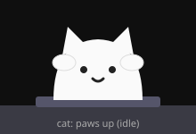 | 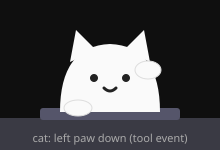 |

## Recommendation

A1 for the avatar and our own cat drawing. Both are canvas-drawn, have zero
licence risk, add no assets or dependencies, and use the fewest frames. B or C
can be layered in later as alternative "skins" behind the same expression events.
